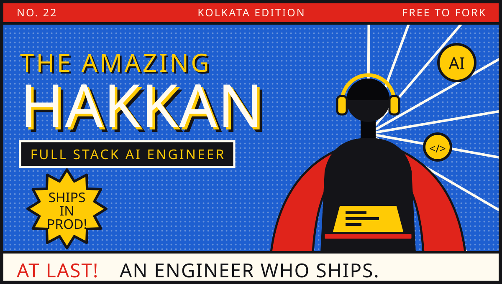
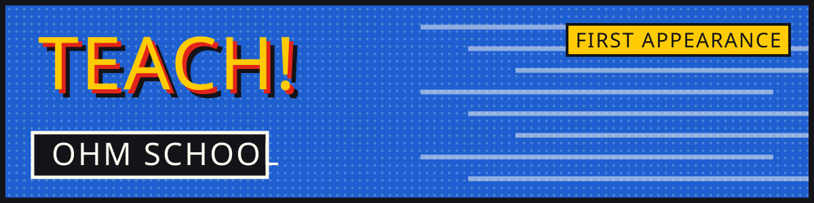
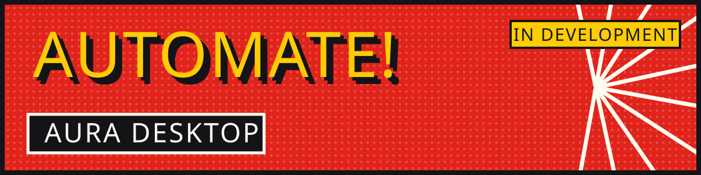
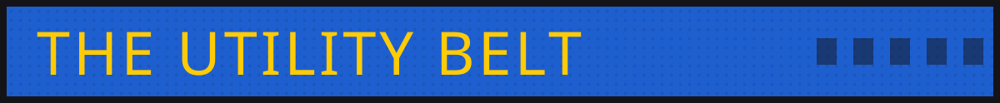
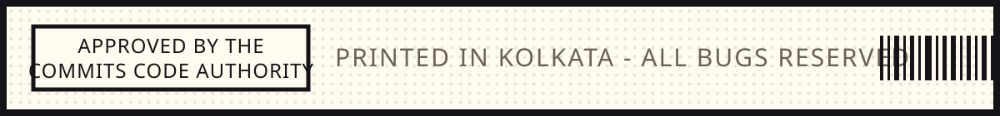

**[Portfolio](https://hakkan.is-a.dev)** &nbsp;·&nbsp;
**[Persist](https://hakkan.persist.org)** &nbsp;·&nbsp;
**[Résumé](https://github.com/HakkanShah/HakkanShah/raw/main/Hakkan_Parbej_Shah_Resume.pdf)** &nbsp;·&nbsp;
**[LinkedIn](https://linkedin.com/in/Hakkan)** &nbsp;·&nbsp;
**[Email](mailto:hakkanparbej@gmail.com)**

**It began with one project that absolutely had to work.** A deadline, no plan B, and the
discovery that *working* beats *clever* every single time.

**Then it met actual users.** Demos are easy. Keeping something up at 3am, under load,
with nobody watching — that turned out to be the real job.

**And so a Full Stack AI Engineer was born.** Now it's AI-first products in production at
**[Persist Ventures](https://persist.org)** — adaptive learning platforms, desktop agents,
and the unglamorous automation that simply keeps running.

An AI learning platform that rearranges the lesson around whoever is sitting in front of it.
Resident tutor **Ollie**, mastery tracking, assessments and recommendations that adapt as
the learner moves. The hard part was never the tutor — it was deciding when someone
genuinely *knows* a thing, cheaply and without flattering them.

`Next.js` `TypeScript` `LLM` `Postgres` &nbsp;→&nbsp; **[ohmschool.org](https://ohmschool.org)**

A desktop AI assistant that can actually press the buttons. Voice interaction in, desktop
and browser automation out, several LLM providers behind a single door so the model is a
choice rather than a dependency.

`Electron` `Node.js` `Voice` `Multi-LLM` &nbsp;→&nbsp; **shipping soon**

A portfolio you drive from a command line. Built on the suspicion that a portfolio should
ask something of the person reading it — the ones who type `help` stay considerably longer
than the ones who scroll.

`React` `Terminal UI` `Vercel` &nbsp;→&nbsp; **[hakkan.is-a.dev](https://hakkan.is-a.dev)**

Keeps the contribution streak alive. A tool about consistency has to be more consistent
than the habit it is protecting, so it runs unattended — that is the whole feature.

`Node.js` `GitHub API` `Cron` &nbsp;→&nbsp; **[commithabit.vercel.app](https://commithabit.vercel.app)**

| | |
|:---|:---|
| **1 · Languages** | Java · TypeScript · JavaScript · Python · C |
| **2 · Frontend** | Next.js · React · Tailwind CSS · Shadcn UI · HTML · CSS |
| **3 · Backend** | Node.js · Express · REST APIs |
| **4 · Database** | MongoDB · PostgreSQL · MySQL · Redis · Firebase · Supabase |
| **5 · AI & LLMs** | OpenAI · Google Gemini · Anthropic Claude · Groq · NVIDIA NIM |
| **6 · Cloud & DevOps** | Git · GitHub · Docker · Vercel · Netlify · Render |

| | | |
|:---|:---|:---|
| AI agents & autonomy | Electron desktop apps | Full stack web platforms |
| AI-powered education | Developer tooling | Voice interfaces |
| RAG & knowledge systems | Premium UI/UX detail | Performance tuning |

AI agents, MCP, RAG and LLM workflows · desktop automation · system design · and the daily
grind of data structures and algorithms.

Write in. Interesting problems get answered first.

| | |
|:---|:---|
| **Portfolio** | [hakkan.is-a.dev](https://hakkan.is-a.dev) |
| **Persist** | [hakkan.persist.org](https://hakkan.persist.org) |
| **Email** | [hakkanparbej@gmail.com](mailto:hakkanparbej@gmail.com) |
| **LinkedIn** | [linkedin.com/in/Hakkan](https://linkedin.com/in/Hakkan) |
| **GitHub** | [github.com/HakkanShah](https://github.com/HakkanShah) |

