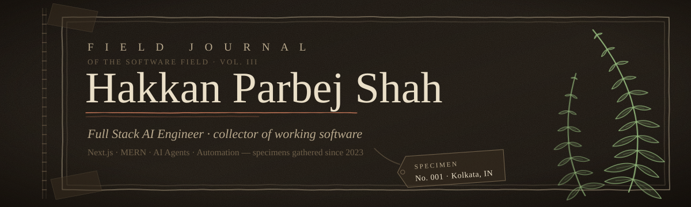
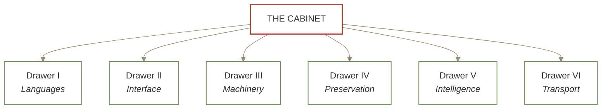

<picture>
  <source media="(prefers-color-scheme: dark)" srcset="assets/journal-header-dark.svg">
  <source media="(prefers-color-scheme: light)" srcset="assets/journal-header-light.svg">
  
</picture>

*Being a record of software observed, collected, and occasionally coaxed into* 
*growing where it was not expected to grow.*

<a href="https://hakkan.is-a.dev">Portfolio</a> &nbsp;·&nbsp;
<a href="https://hakkan.persist.org">Persist</a> &nbsp;·&nbsp;
<a href="https://github.com/HakkanShah/HakkanShah/raw/main/Hakkan_Parbej_Shah_Resume.pdf">Résumé</a> &nbsp;·&nbsp;
<a href="https://linkedin.com/in/Hakkan">LinkedIn</a> &nbsp;·&nbsp;
<a href="mailto:hakkanparbej@gmail.com">Post</a>

<picture>
  <source media="(prefers-color-scheme: dark)" srcset="assets/journal-rule-dark.svg">
  <source media="(prefers-color-scheme: light)" srcset="assets/journal-rule-light.svg">
  
</picture>

## Entry I &nbsp;·&nbsp; Notes on the Collector

I'm a **Full Stack AI Engineer**. I build things that have to survive contact with
real users — AI-first web applications, desktop agents, and automation that runs
unattended and is expected to still be standing in the morning.

My interest is the seam where modern web engineering meets language models: not
demos, but systems that hold up. I collect the ones that do.

Currently in residence at [**Persist Ventures**](https://persist.org), remote, where I build
and maintain AI products in production.

> *On method:* ship it, watch it in the wild, write down what actually happened,
> go back and fix the thing you were wrong about.

### The Field Log

| № | STATUS | ENTRY |
|:---|:---|:---|
| `01` | *In the field* | [**OHM School**](https://ohmschool.org) — adaptive learning platform. An AI tutor named Ollie, mastery tracking, assessments, and recommendations that reshape themselves around each learner. |
| `02` | *In the field* | **Aura Desktop** — an AI assistant that lives on the desktop. Voice interaction, desktop and browser automation, multiple LLM providers behind one interface. |
| `03` | *Under glass* | Scaling production work on **Next.js, React, TypeScript, Node.js, Supabase, Firebase** and assorted AI APIs. |
| `04` | *Germinating* | Tracking the behaviour of **AI agents, MCP, RAG, LLM workflows, desktop automation** and system design in the wild. |
| `05` | *Daily practice* | **Data structures and algorithms** — sharpening the knife, so to speak. |

<picture>
  <source media="(prefers-color-scheme: dark)" srcset="assets/journal-rule-dark.svg">
  <source media="(prefers-color-scheme: light)" srcset="assets/journal-rule-light.svg">
  
</picture>

## Entry II &nbsp;·&nbsp; Specimen Plates

<table>
<tr><td width="33%" valign="top">

### Plate I

**[OHM School](https://ohmschool.org)** 
*Schola adaptiva*

Teaches, then rearranges itself
around what the learner just got
wrong. Houses a resident AI tutor.

`Next.js` `TypeScript` `LLM` `Postgres`

</td><td width="33%" valign="top">

### Plate II

**[Portfolio](https://hakkan.is-a.dev)** 
*Terminalis personalis*

A portfolio that answers to a
command line. Rewards the visitor
willing to type.

`React` `Terminal UI` `Vercel`

</td><td width="33%" valign="top">

### Plate III

**[CommitHabit](https://commithabit.vercel.app)** 
*Habitus quotidianus*

Cultivates a contribution streak.
A study in making a small daily
act impossible to forget.

`Node.js` `GitHub API` `Cron`

</td></tr>
</table>

<b>&nbsp;Lift the specimen tag &nbsp;·&nbsp; further notes from the field</b>

 

**Plate I — *Schola adaptiva.*** The interesting problem was never the tutor; it was
mastery tracking. Deciding that a learner *knows* something is a judgement call,
and the model has to make it repeatedly, cheaply, and without being flattering.

**Plate II — *Terminalis personalis.*** Built on the suspicion that a portfolio
should ask something of the person reading it. The ones who type `help` stay
considerably longer than the ones who scroll.

**Plate III — *Habitus quotidianus.*** A tool about consistency, which means the
tool itself has to be more consistent than the habit it is protecting. It runs
unattended; that is the whole feature.

<picture>
  <source media="(prefers-color-scheme: dark)" srcset="assets/journal-rule-dark.svg">
  <source media="(prefers-color-scheme: light)" srcset="assets/journal-rule-light.svg">
  
</picture>

## Entry III &nbsp;·&nbsp; The Collector's Cabinet

*Contents of the drawers, arranged by family.*

| DRAWER | FAMILY | CONTENTS |
|:---|:---|:---|
| `I` | **Languages** | Java · TypeScript · JavaScript · Python · C |
| `II` | **Interface** | Next.js · React · Tailwind CSS · Shadcn UI · HTML · CSS |
| `III` | **Machinery** | Node.js · Express · REST APIs |
| `IV` | **Preservation** | MongoDB · PostgreSQL · MySQL · Redis · Firebase · Supabase |
| `V` | **Intelligence** | OpenAI · Google Gemini · Anthropic Claude · Groq · NVIDIA NIM |
| `VI` | **Transport** | Git · GitHub · Docker · Vercel · Netlify · Render |

<picture>
  <source media="(prefers-color-scheme: dark)" srcset="assets/journal-rule-dark.svg">
  <source media="(prefers-color-scheme: light)" srcset="assets/journal-rule-light.svg">
  
</picture>

## Entry IV &nbsp;·&nbsp; Growth Records

*Measured over successive seasons. The specimen prefers consistent light.*

<picture>
  <source media="(prefers-color-scheme: dark)" srcset="https://streak-stats.demolab.com?user=HakkanShah&background=17120D&border=4A3C2C&stroke=4A3C2C&ring=93B87C&fire=D4805E&currStreakNum=EADFC8&sideNums=EADFC8&currStreakLabel=93B87C&sideLabels=B9A98D&dates=6E5F49&border_radius=4">
  <source media="(prefers-color-scheme: light)" srcset="https://streak-stats.demolab.com?user=HakkanShah&background=F7F1E1&border=C9B99B&stroke=C9B99B&ring=4A6B3F&fire=A8452F&currStreakNum=3A3028&sideNums=3A3028&currStreakLabel=4A6B3F&sideLabels=6B5E4B&dates=A8977A&border_radius=4">
  
</picture>

<picture>
  <source media="(prefers-color-scheme: dark)" srcset="assets/journal-rule-dark.svg">
  <source media="(prefers-color-scheme: light)" srcset="assets/journal-rule-light.svg">
  
</picture>

## Entry V &nbsp;·&nbsp; Observed Behaviours

*Habits reliably displayed by the specimen when left to its own devices.*

| | | |
|:---|:---|:---|
| 🌱 &nbsp;Builds AI agents and lets them run | 🌿 &nbsp;Keeps desktop applications alive | 🍃 &nbsp;Raises full stack web platforms |
| 🌱 &nbsp;Teaches machines to teach people | 🌿 &nbsp;Sharpens its own tools first | 🍃 &nbsp;Talks to software out loud |
| 🌱 &nbsp;Feeds knowledge into retrieval systems | 🌿 &nbsp;Fusses over interface detail | 🍃 &nbsp;Cannot leave a slow page alone |

<picture>
  <source media="(prefers-color-scheme: dark)" srcset="assets/journal-rule-dark.svg">
  <source media="(prefers-color-scheme: light)" srcset="assets/journal-rule-light.svg">
  
</picture>

## Entry VI &nbsp;·&nbsp; Correspondence

*The collector answers letters. Interesting problems move to the front of the pile.*

| | ADDRESS |
|:---|:---|
| **Portfolio** | [hakkan.is-a.dev](https://hakkan.is-a.dev) |
| **Persist** | [hakkan.persist.org](https://hakkan.persist.org) |
| **Post** | [hakkanparbej@gmail.com](mailto:hakkanparbej@gmail.com) |
| **LinkedIn** | [linkedin.com/in/Hakkan](https://linkedin.com/in/Hakkan) |
| **This cabinet** | [github.com/HakkanShah](https://github.com/HakkanShah) |

<picture>
  <source media="(prefers-color-scheme: dark)" srcset="assets/journal-rule-dark.svg">
  <source media="(prefers-color-scheme: light)" srcset="assets/journal-rule-light.svg">
  
</picture>

  

*Colophon — set in Georgia, pressed between Kolkata and the open internet.* 
*Observe. Build. Record. Return.*

