 

  

<b>Read this profile as plain text</b> &mdash; for search engines, screen readers, and if the images do not load

## Hakkan Shah &mdash; Full Stack AI Engineer

Kolkata, India &middot; remote &middot; currently at [Persist Ventures](https://persist.org)

I build AI-first products that have to survive real users: adaptive learning platforms,
desktop agents, and automation that keeps running unattended.

### Projects

- **[OHM School](https://ohmschool.org)** &mdash; an AI-powered learning platform that rearranges the
  lesson around whoever is using it. Resident tutor Ollie, mastery tracking, assessments and
  adaptive recommendations. *Next.js, TypeScript, LLM.*
- **[Aura Desktop](https://aura-website-ashen.vercel.app/)** &mdash; a desktop AI assistant you chat or
  speak to, which books flights, applies to jobs and summarises mail. Beta v0.2.0.
  *Electron, Node.js, voice, multi-LLM.*
- **[Portfolio](https://hakkan.is-a.dev)** &mdash; a developer portfolio you drive from a command line.
  *React, terminal UI, Vercel.*
- **[CommitHabit](https://commithabit.vercel.app)** &mdash; keeps a GitHub contribution streak alive,
  unattended. *Node.js, GitHub API, cron.*

### Tech stack

| | |
|:--|:--|
| **Languages** | Java, TypeScript, JavaScript, Python, C |
| **Frontend** | Next.js, React, Tailwind CSS, Shadcn UI, HTML, CSS |
| **Backend** | Node.js, Express, REST APIs |
| **Databases** | MongoDB, PostgreSQL, MySQL, Redis, Firebase, Supabase |
| **AI & LLMs** | OpenAI, Google Gemini, Anthropic Claude, Groq, NVIDIA NIM |
| **Cloud & DevOps** | Git, GitHub, Docker, Vercel, Netlify, Render |

Also: AI agents and autonomous workflows, MCP, RAG and knowledge systems, Electron desktop
apps, voice interfaces, developer tooling, UI/UX detail, performance tuning.

### Contact

- Portfolio &mdash; [hakkan.is-a.dev](https://hakkan.is-a.dev)
- Persist &mdash; [hakkan.persist.org](https://hakkan.persist.org)
- Email &mdash; [hakkanparbej@gmail.com](mailto:hakkanparbej@gmail.com)
- LinkedIn &mdash; [linkedin.com/in/Hakkan](https://linkedin.com/in/Hakkan)
- GitHub &mdash; [github.com/HakkanShah](https://github.com/HakkanShah)
- [Resume (PDF)](https://github.com/HakkanShah/HakkanShah/raw/main/Hakkan_Parbej_Shah_Resume.pdf)

